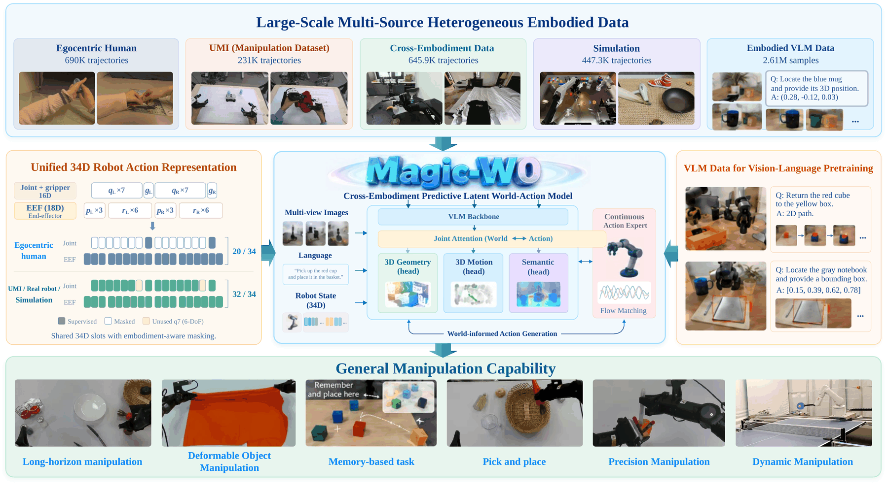

<div align="center">


# MagicW0: A Structured World–Action Foundation Model for Physical Intelligence

*Magic-Lab Team · Magiclab Robotics Inc.*

<a href="https://embodied.magiclab.top/works/wam/magic-w0/index.html"></a> <a href="https://github.com/MagiclabRobotics/Magic-W0"></a> <a href="LICENSE"></a>
<br>
<a href="https://huggingface.co/XuhuaX/Magic-W0"></a>

[Update News](#update-news) · [Abstract](#abstract) · [Key Features](#key-features) · [Getting Started](#getting-started) · [Training](#training) · [Repository Structure](#repository-structure)

</div>

<a name="update-news"></a>

## 📣 Update News

- **[2026-10-30]** Released code for **multi-source pretraining** and **RoboDojo post-training (SFT)**, with example configs, data preparation, normalization and checkpoint export. See the [training guide](docs/training.md).
- **[2026-10-30]** Released **pretrained** and **RoboDojo fine-tuned** checkpoints on [Hugging Face](https://huggingface.co/XuhuaX/Magic-W0). See the [model guide](docs/models.md) for downloads and teacher/backbone resources.
- **[2026-10-05]** Added the RoboDojo inference adapter and deployment configuration.
- **[2026-09-30]** Added the project overview.

<a name="abstract"></a>

## 📖 Abstract

MagicW0 learns structured world transitions and continuous robot actions from diverse embodied experience. It represents the current scene, action-induced 3D motion, and task-relevant future semantics, and couples world prediction with action generation through layer-aligned interaction. Pretrained on approximately 2.014M effective action episodes and 2.61M visual-language samples, it achieves 99.05% average success on LIBERO and 94.6% across five real-robot tasks after downstream fine-tuning.

<p align="center">
  
</p>

<a name="key-features"></a>

## ✨ Key Features

- 🌍 **World–action modeling:** learn geometry, motion, future semantics, and continuous control together.
- 🤖 **Cross-embodiment data:** use a shared 34D state–action interface with masks for missing dimensions.
- ⚡ **Teacher-free policy execution:** use Track4World and DINOv3 supervision during training without running these teachers at inference.
- 🕒 **Visual history:** retain checkpoint-configured past observations independently for each environment.
- 🛠️ **RoboDojo integration:** serve batched actions with checkpoint validation, normalization, and camera-frame EEF conversion.

<a name="getting-started"></a>

## 🚀 Getting Started

This repository provides MagicW0 **pretraining, post-training (SFT),
and inference**, together with public checkpoints and the RoboDojo adapter.

### Installation

Use Linux, Python 3.11, and an NVIDIA GPU. Run from the repository root:

```bash
git clone https://github.com/MagiclabRobotics/Magic-W0.git
cd Magic-W0
conda create -n magic-w0 python=3.11 -y
conda activate magic-w0
bash scripts/install.sh
```

The default installer uses PyTorch 2.5.1 / CUDA 12.1 for inference. For training,
use `bash scripts/install.sh --train` (PyTorch 2.7.1 / CUDA 12.6). Install RoboDojo, Isaac Sim, assets,
and the required XPolicyLab extensions in a separate simulator environment;
see the [inference guide](docs/robodojo.md).

### Model Resources

Model repository: [🤗 Hugging Face](https://huggingface.co/XuhuaX/Magic-W0).
See the [model guide](docs/models.md) for pinned policy, backbone and FAST downloads.

| Checkpoint | Use |
| --- | --- |
| [Pretrained MagicW0](https://huggingface.co/XuhuaX/Magic-W0/tree/main/pretrain_models) | Initialize downstream post-training |
| [RoboDojo fine-tuned MagicW0](https://huggingface.co/XuhuaX/Magic-W0/tree/main/robodojo_sft_models) | RoboDojo inference and evaluation |

Prepare a compatible local policy checkpoint and the pinned Qwen configuration,
tokenizer, and processor assets:

```bash
python scripts/prepare_resources.py \
  --checkpoint-source /path/to/magic_w0_robodojo.pt \
  --download-qwen
python scripts/prepare_resources.py --check
```

Files are prepared under `checkpoints/`. For inference and checkpoint-based
fine-tuning, Qwen base weights are unnecessary: the policy checkpoint contains
the learned VLM tensors. Fresh pretraining requires Qwen base weights.

### RoboDojo Evaluation

```bash
export ROBODOJO_ROOT=/path/to/RoboDojo
bash eval/robodojo/run.sh \
  --task stack_bowls --seed 0 --episodes 10 \
  --policy-name Magic_W0_Local \
  --policy-gpu 0 --env-gpu 1 --sim-env RoboDojo
```

For a single GPU, use `--env-gpu 0` and reduce the simulator's environment count.
Select the simulator configuration with `--env-config YOUR_ARX_ENV_CONFIG`.
Add `--dry-run` to inspect the launch commands. Deployment defaults are in
[`configs/robodojo.yaml`](configs/robodojo.yaml): **10 inference steps** and
**20 executed actions per replan**. Logs and resolved settings are saved under
`runs/robodojo/`; task success is recorded in RoboDojo's native result files.
See the [inference guide](docs/robodojo.md) for resource overrides and multiple tasks.

<a name="training"></a>

### Pretraining and Post-training

The supplied configs are minimal examples with illustrative hyperparameters;
they are not the original experiment recipes.

Install training dependencies and prepare the data, normalization statistics
and model resources described in the [training guide](docs/training.md):

```bash
bash scripts/install.sh --train
bash scripts/train.sh --config configs/train/robodojo_sft.yaml --dry-run
NPROC_PER_NODE=8 bash scripts/train.sh --config configs/train/robodojo_sft.yaml
```

For multi-source pretraining, use `configs/train/pretrain.yaml` and configure
each data source. See [data preparation](docs/data.md) and
[checkpoint export](docs/checkpoints.md) to connect training to the existing
inference runtime.

<a name="repository-structure"></a>

## 🗂️ Repository Structure

```text
configs/                 Inference settings and training/data recipes
constraints/             Validated training runtime versions
src/magic_w0/
  modeling.py            Public inference runtime
  processing.py          Inference input processing
  models/                MagicW0 backbone, world experts and teacher adapters
  data/                  Dataset loaders, sampling and normalization
  training/              Distributed training, resume and checkpoint saving
scripts/                 Setup, resource/data checks, training and export
eval/robodojo/           RoboDojo deployment and evaluation
docs/                    Training, data, checkpoints and inference guides
third_party/             Pinned teacher source preparation and patches
tests/                   Unit and integration tests
```

Model weights, datasets and run outputs are stored locally and excluded from Git.

For bug reports and contributions, see [CONTRIBUTING.md](CONTRIBUTING.md).

## 🙏 Acknowledgements

We thank the Hugging Face and LeRobot communities for their infrastructure and tooling. MagicW0 builds on Qwen3.5, Track4World, Depth Anything 3, DINOv3, and FAST. We also thank the LIBERO and RoboDojo teams for their evaluation benchmarks.

## 📚 Citation

If you find MagicW0 useful for your research, please cite our paper:

```bibtex
@article{chen2026magicw0,
  title   = {Magic-W0: A Structured World--Action Foundation Model for Physical Intelligence},
  author  = {Chen, Xuhua and Yin, Zhenhan and Zhang, Yuan and Zhang, Tao and others},
  journal = {arXiv preprint arXiv:2609.39870},
  year    = {2026},
  url     = {https://arxiv.org/abs/2609.39870}
}
```

## 📜 License

Released under the **MIT License**. See [LICENSE](LICENSE) for the full terms.
Third-party components retain their own licenses; see [NOTICE](NOTICE) and
the [model license notes](docs/models.md). The training teachers include
academic-use and noncommercial resources.
